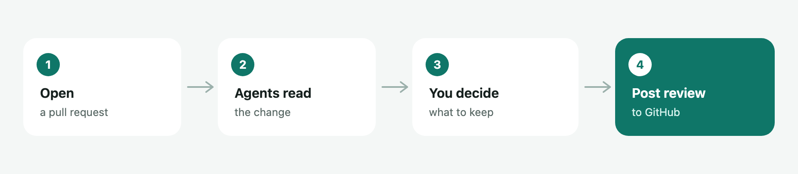

# X-RayView

Review GitHub pull requests in VS Code or Cursor. Agents on your computer read the change. You decide what to keep, then you post the review.



The user guide, with the review page, the model picker, and every setting, is at **[xanadupia.github.io/xrayviewer](https://xanadupia.github.io/xrayviewer)**. That page is generated from [assets/readme.md](assets/readme.md), which is also the page on the Marketplace and inside the extension.

## Install

You need VS Code 1.95 or later, or Cursor, plus `gh auth login`, `git`, and one of Cursor Agent, Claude Code, Codex, or Pi.

Once the listing is live, search for **X-RayView** by Ali Qaryan. The id is `aliqaryan.xrayviewer`. VS Code installs it from the Visual Studio Marketplace. Cursor installs it from Open VSX.

From a checkout, before or after that listing. Building needs Node 26 or later: Volta picks it up from `package.json`, nvm from `.nvmrc`, and npm refuses older versions.

```sh
npm install
npm test
npm run package
cursor --install-extension build/xrayviewer-0.4.1.vsix --force
# or: code --install-extension build/xrayviewer-0.4.1.vsix --force
```

## Develop

| Path | What it is |
|---|---|
| `vendor/base/` | The base extension bundle, review page, and manifest. SHA-256 sums are in `vendor/base.sha256`. |
| `src/` | The Cursor agent runner, the model list, the model picker, Claude Code's /code-review, and the agent activity read from each CLI's event stream. Bundled to `dist/cursor-harness.cjs`. |
| `scripts/patches.mjs` | Edits to the base bundle and review page. Each anchor must appear once. |
| `scripts/activity-ui.mjs` | The Agent activity sheet, copied into the review page. |
| `scripts/manifest.mjs` | Turns `vendor/base/package.json` into the published manifest. The version lives here. |
| `scripts/guide-site.mjs` | Renders the user guide website from `assets/readme.md`. |
| `scripts/build.mjs` | Checks the vendor sums, applies the edits, bundles `src/`, and packages. |
| `assets/` | The user guide, changelog, license, and icons. |
| `docs/` | The pictures, and the user guide website GitHub Pages serves. |
| `test/` | Unit tests, build checks, and a wiring test against a fake Cursor CLI. |

```sh
npm test
npm run typecheck
npm run site             # rewrite docs/index.html after a guide edit
npm run package          # build/xrayviewer-0.4.1.vsix
```

`node test/live/review-e2e.ts [model] [report.json]` runs a real review with the signed-in Cursor Agent CLI. It uses account usage, so it is not part of `npm test`.

Publishing steps are in [PUBLISHING.md](PUBLISHING.md). Building and sending a change are in [CONTRIBUTING.md](CONTRIBUTING.md).

## License

MIT. See [LICENSE](LICENSE).
