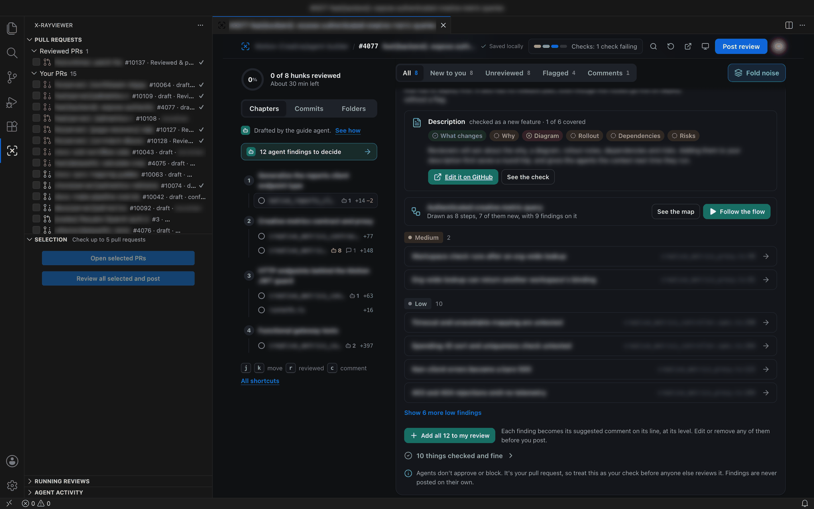

# X-RayViewer

Review GitHub pull requests in VS Code or Cursor. Agents on your computer read the change before you do: they check the description, set a reading order, draw the flow, and flag problems on the lines. You keep what you agree with and post one review.




The user guide walks through a first review with screenshots, then covers automatic runs, models, custom agents, and every setting: **[xanadupia.github.io/xrayviewer](https://xanadupia.github.io/xrayviewer)**. It's generated from [assets/readme.md](assets/readme.md), which is also the page on the Marketplace and inside the extension.

## Install

You need VS Code 1.95 or later, or Cursor, plus `gh auth login`, `git`, and one of Claude Code, Codex, or Cursor Agent.

In VS Code, search for **X-RayViewer** by Ali Qaryan in the Extensions view. The id is `aliqaryan.xrayviewer`. Cursor installs extensions from Open VSX, where it isn't listed yet, so download the `.vsix` from the [latest release](https://github.com/Xanadupia/xrayviewer/releases/latest), or build it below, and run **Extensions: Install from VSIX…**.

Building needs Node 26 or later: Volta picks it up from `package.json`, nvm from `.nvmrc`, and npm refuses older versions.

```sh
npm install
npm test
npm run package
cursor --install-extension build/xrayviewer-0.5.5.vsix --force
# or: code --install-extension build/xrayviewer-0.5.5.vsix --force
```

## Develop

| Path | What it is |
|---|---|
| `vendor/base/` | The base extension bundle, review page, and manifest. SHA-256 sums are in `vendor/base.sha256`. |
| `src/` | The Cursor agent runner, the model list, the model picker, the built-in reviews (Claude Code's /code-review, Codex's `review --base`, and Cursor's /review-bugbot), the sidebar's hover card, and the agent activity read from each CLI's event stream. Bundled to `dist/cursor-harness.cjs`. |
| `scripts/patches.mjs` | Edits to the base bundle and review page. Each anchor must appear once. |
| `scripts/activity-ui.mjs` | The Agent activity sheet, copied into the review page. |
| `scripts/manifest.mjs` | Turns `vendor/base/package.json` into the published manifest. The version lives here. |
| `scripts/guide-site.mjs` | Renders the user guide website from `assets/readme.md`. |
| `scripts/build.mjs` | Checks the vendor sums, applies the edits, bundles `src/`, and packages. |
| `assets/` | The user guide, changelog, license, and icons. |
| `docs/` | The screenshots, the diagram (`how-it-works.svg` and its PNG), and the user guide website GitHub Pages serves. |
| `test/` | Unit tests, build checks, and a wiring test against a fake Cursor CLI. |
| `scripts/release.mjs` | Checks a release tag against `VERSION` and the changelog, and writes the release notes. |
| `.github/` | CI on Linux and macOS for every pull request and push to `main`, the release workflow a `v*` tag starts, and Dependabot. |

```sh
npm test
npm run typecheck
npm run site             # rewrite docs/index.html after a guide edit
npm run package          # build/xrayviewer-0.5.5.vsix
```

`node test/live/review-e2e.ts [model] [report.json]` runs a real review with the signed-in Cursor Agent CLI. It uses account usage, so it is not part of `npm test`.

Each release on [GitHub](https://github.com/Xanadupia/xrayviewer/releases) has the `.vsix`, and pushing a `v*` tag cuts one. The steps are in [PUBLISHING.md](PUBLISHING.md). Building and sending a change are in [CONTRIBUTING.md](CONTRIBUTING.md).

## License

MIT. See [LICENSE](LICENSE).
